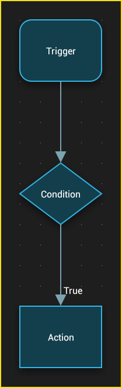
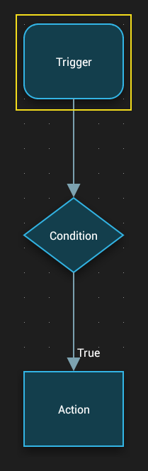
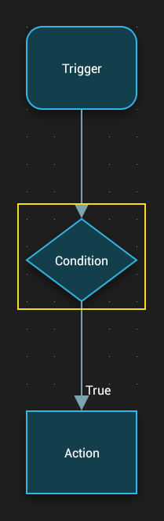
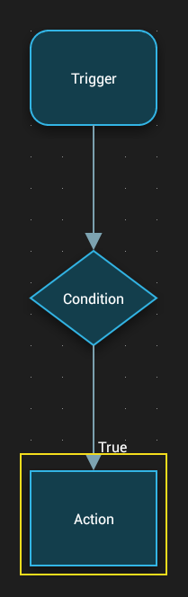

# Base Concepts

## Flow

An automatic process executed by Automagic is defined using a flow.

A flow consists of three types of elements:

- Trigger
- Condition
- Action

A flow can consist of an unlimited number of such elements. The same trigger, condition or action can be used in more than one flow. Changes to an element affect all flows where this element is used.

## Triggers

A trigger initiates the flow whenever some type of event is detected by the system.

Several types of triggers exist:

- Time
- Location
- Shortcut
- Incoming SMS (Premium)
- Battery State (Premium)
- Power State (Premium)
- [...and many more...](../components/README.md#triggers)

Multiple triggers can be added to the same flow. A flow is executed when **one** of the triggers receives an event.

## Conditions

A condition executes a check and continues the flow depending on the result on one of the two possible outputs **true** or **false**.

Several types of conditions exist:

- Gleeo is recording
- Location
- Time range
- Confirmation dialog
- Expression (Premium)
- [...and many more...](../components/README.md#conditions)

A flow stops executing when a condition is evaluated to an output that has no subsequent conditions or actions defined.

## Actions

An action executes an operation or changes a setting.

Several types of actions exist:

- Gleeo Start Recording
- Gleeo Stop Recording
- Gleeo Filesystem Export
- Turn WiFi on/off (Premium)
- Turn Flightmode on/off (Premium)
- Send SMS (Premium)
- Send mail (Premium)
- Change audio settings (Premium)
- [...and many more...](../components/README.md#actions)

## Variables

Variables are a very powerful feature and can be used to define a part of a text dynamically.

Example: Every trigger stores the time of execution in a variable called **triggertime**.
You can show the time in an action **Notification on Screen** by defining the text '**It is {triggertime}**'.

A variable can be formatted using patterns like **{triggertime,dateformat,HH:mm}** to show the time as **14:35**.
Every trigger, condition and action can make variables available to a flow. See the the **Help** of each object to see what variables are made available to the flow.

**Global Variables** start with **global\_** and are available in all flows and are kept when the flow has ended.

Variables can be modified using action **Script** and can be evaluated using condition **Expression**.

---

[← Indeks panduan](README.md) · [Peta dokumentasi](../README.md)
