# Creating a Custom Widget

This tutorial is a guide to build a basic custom widget that displays the current time and battery level.
The widget will open the device clock app when the upper half of the widget is pressed and will open the battery usage summary when the lower half of the widget is pressed.

## Step 1 - Creating a new Custom Widget

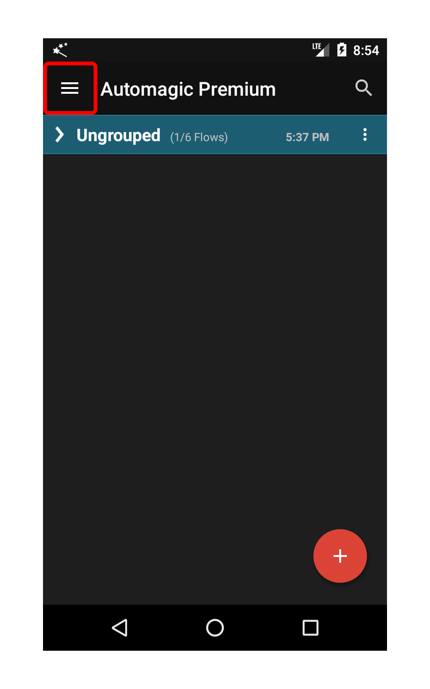

Press the marked button to open the navigation drawer.

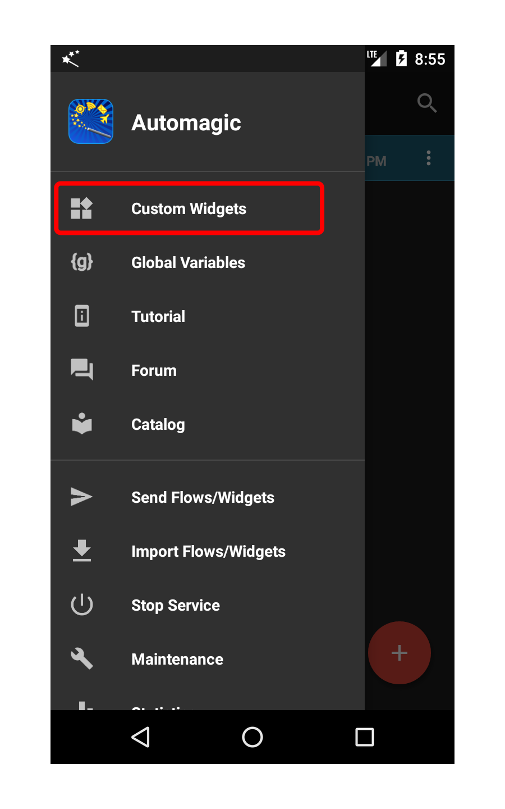

Select **Custom Widgets** to open the list with your custom widgets.

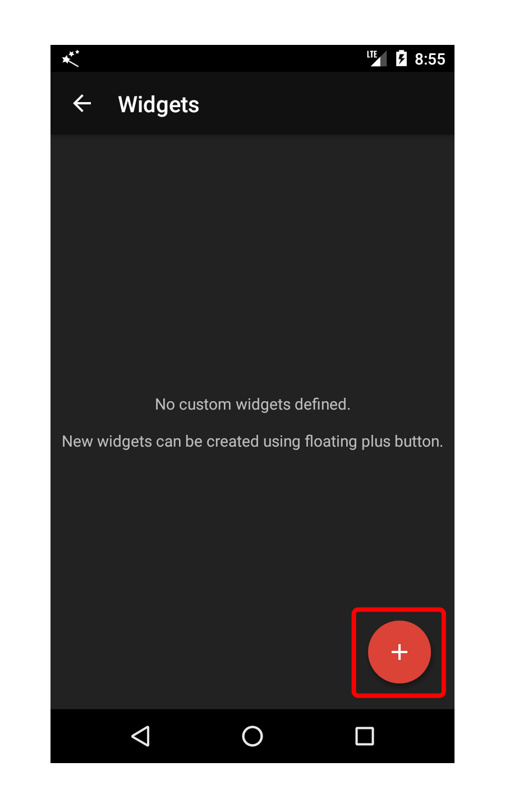

The list is empty since no custom widgets exist yet. Select the **plus button** button in the lower right corner to create a new widget.

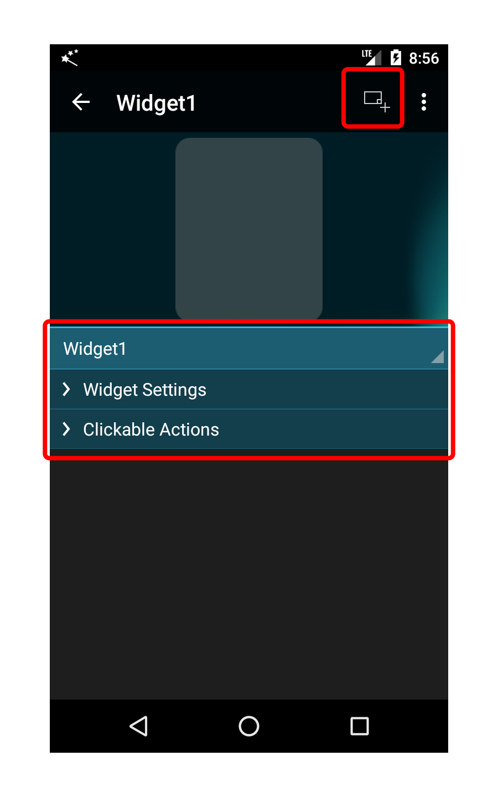

The widget initially consists of an empty, semi transparent background with rounded corners.

The lower half of the screen shows the currently selected element in a dropdown. The complete widget is selected by default, thus the dropdown contains the name of the widget itself.

The sections **Widget Settings** and **Clickable Actions** are groups of properties pertaining to the widget in general. The property groups can be expanded and collapsed by touching on the group name.

We are going to add a text element to the widget to show the current time on the widget.
Select **Add Element** in the action bar to add a new element.

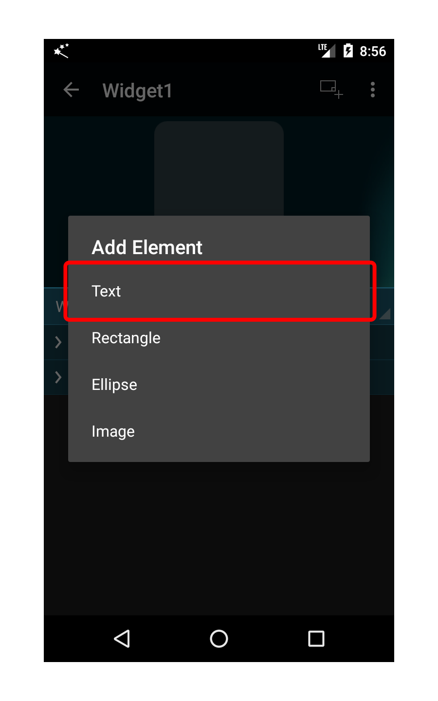

The list of the available element types is shown.

Select **Text** to create an element that can display one or multiple lines of text.

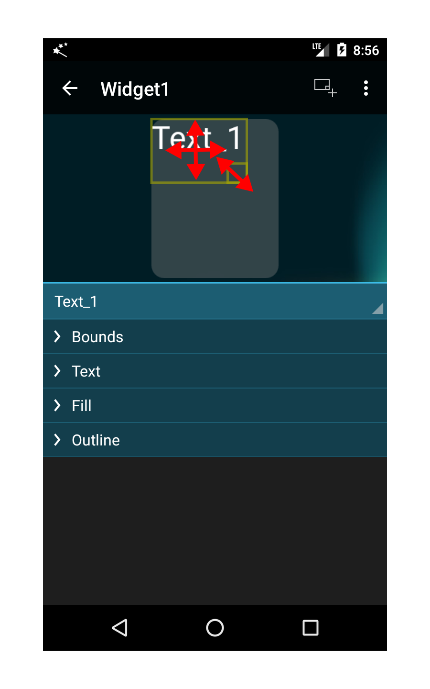

The new text element is placed on the upper left corner of the widget and initially contains the static text **Text 1**.

An element on a widget can be moved around by dragging and can be resized by dragging the lower right corner of the element.

Note that different widget property sections are available now, since every type of widget element has specific properties that can be adjusted.

A text element contains:

- **Bounds**: to adjust position, size and rotation
- **Text**: to adjust the displayed text, typeface, alignment etc.
- **Fill**: to adjust fill color, shadow properties of the fill shape
- **Outline**: to adjust outline color, outline width and shadow of the outline shape

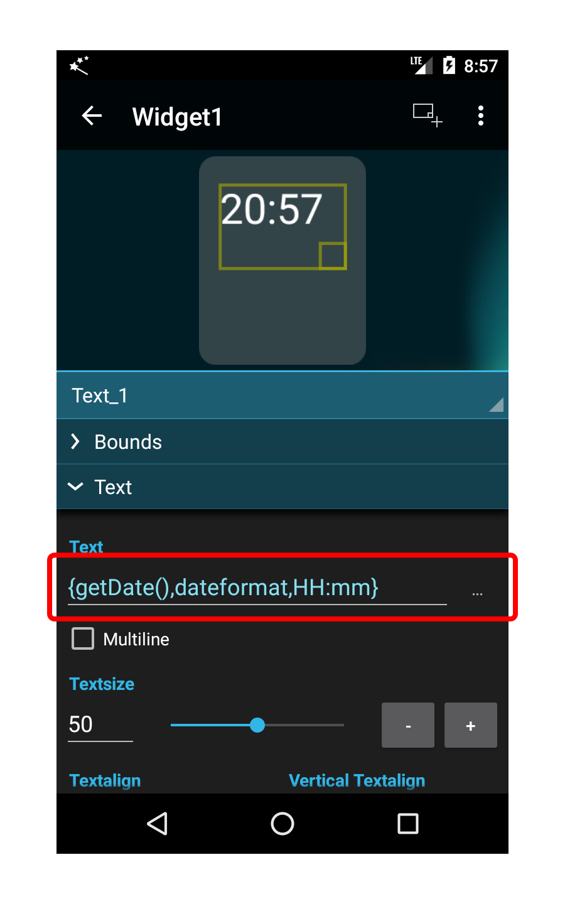

Drag the text element approximately to the upper half of the widget. You can also expand the property group **Bounds** and enter the position manually or precisely move the element with the arrow buttons.

Since the text element should not show a static but a dynamic text, we will enter a short inline expression that will dynamically evaluate to the current time. You can use the [...]-button to select the predefined text from the list.

The function **getDate** returns the current time.
**dateformat** instructs Automagic to format the value as a date.
**HH:mm** instructs Automagic to use the 24-hour format for the hours and format the minutes to two digits. You can also use the pattern **hh:mm a** to format to the 12-hour AM/PM format.

Note that the widget design area directly executes the inline expression and displays the current formatted time.

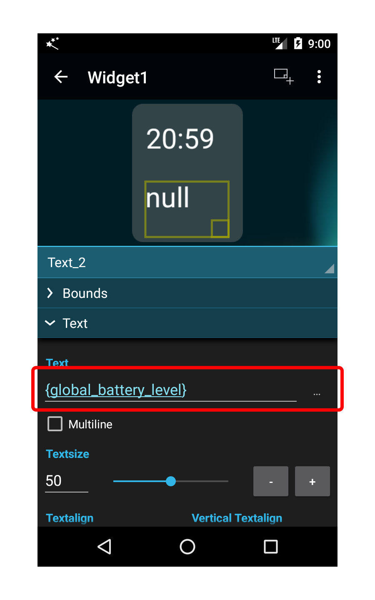

To display the battery level, we have to add another text element to the widget.
Select the **Add Element** button in the action bar again and place the element in the lower half of the widget and set the text to **{global\_battery\_level}**.
This instructs Automagic to display the contents of the global variable **global\_battery\_level**.
Since the variable does not exist yet, the value **null** is displayed.

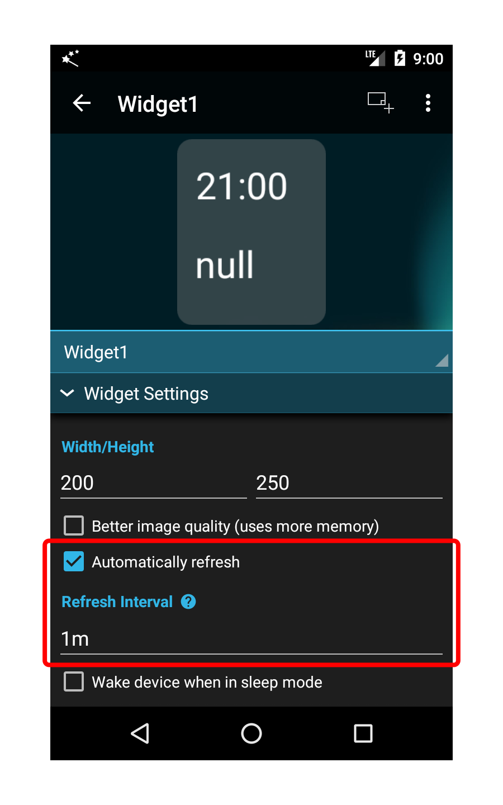

Automagic only refreshes a widget when it detects either a change in a global variable that is used by the widget or when a property of a widget element is modified. Since neither is the case in the text element that displays the time, we have to instruct Automagic to refresh the widget every minute.

Select the widget in the dropdown list or touch a free area in the design area.
Expand the property group **Widget Settings**.
Check **Automatically refresh** and set the refresh interval to one minute.

Press **Back** to leave the widget design area and to go back to the widget list.

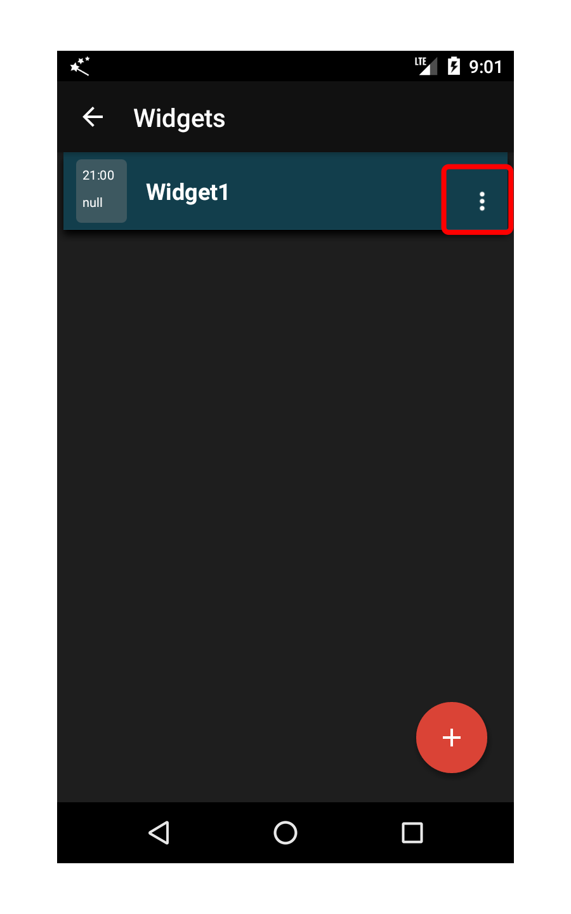

Select the widget menu to open the list of actions for your widget and select **Rename** to give the widget the name **Info Widget**.

Press **Back** to leave the widget list and to go back to the flow list.

## Step 2 - Updating the battery level

In this step we are going to create a flow that updates the global variable containing the battery level.
Create a new flow and add a trigger **Battery Level**.

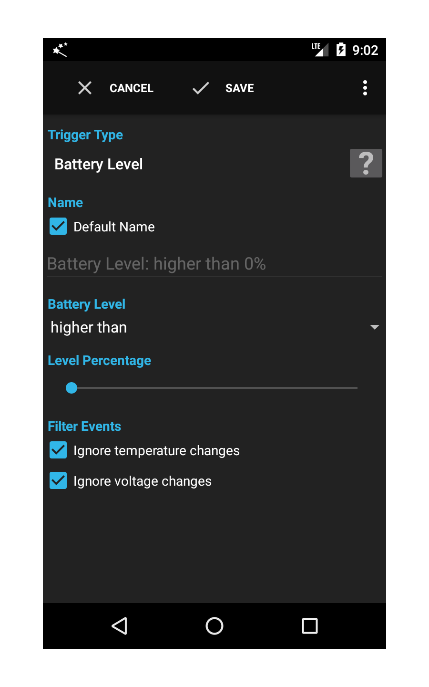

Configure the trigger as shown on the screenshot.
This will ensure that the flow is executed whenever the battery level changes and will provide the variable **battery\_level** to the flow.
Please also check both ignore-checkboxes in the filter since some devices will execute the trigger very often when the device is connected to a charger.

Now we have to fill the battery level available in the local variable **battery\_level** into the global variable **global\_battery\_level** used by the widget.
Add an action **Script** to the flow.

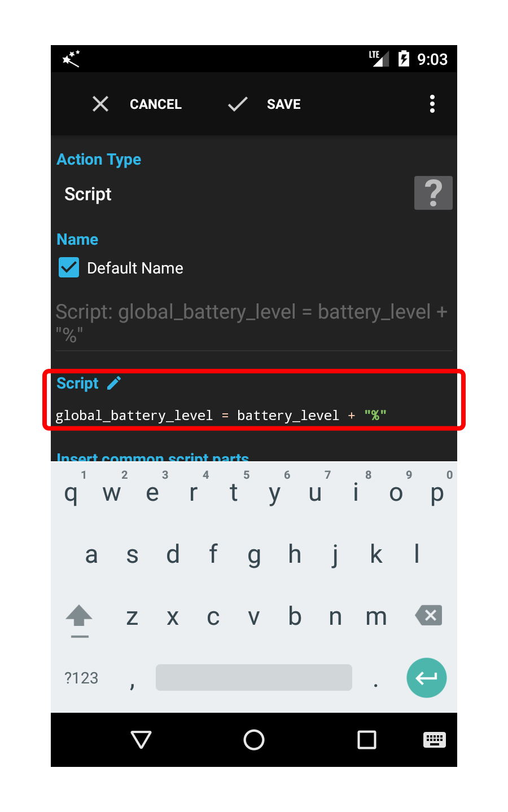

Configure the action **Script** as shown in the screenshot.
The script **global\_battery\_level = battery\_level + "%"** reads the battery\_level available in the flow, appends a percent character and stores the resulting string in the global variable **global\_battery\_level**.

The global variable **global\_battery\_level** will contain a value like **65%** when the flow is executed. The widget will display this value since we instructed the text element on the widget to show the contents of the variable with **{global\_battery\_level}**.

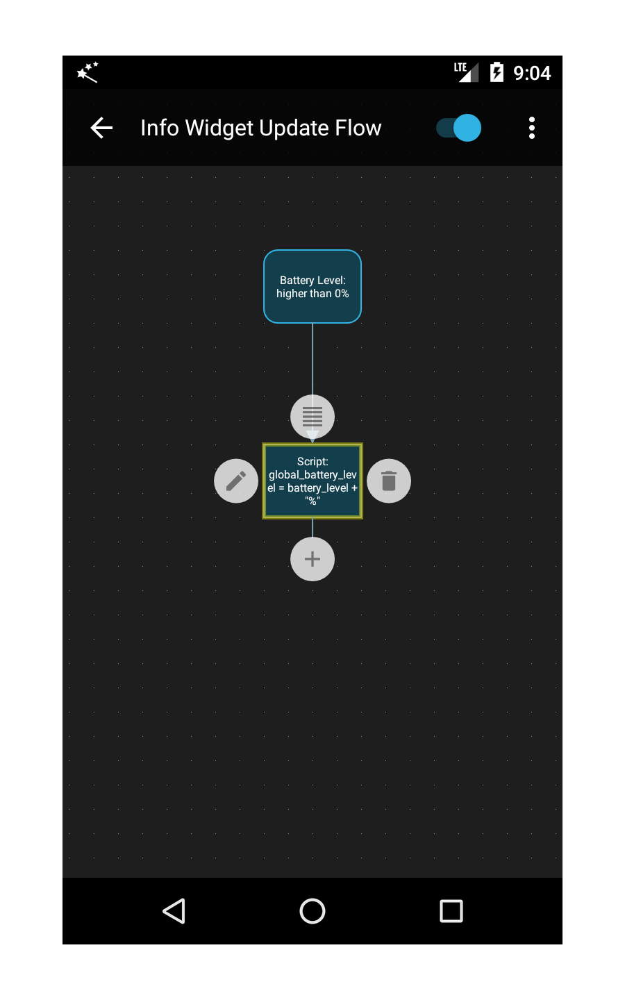

The complete flow should look as shown in the screenshot.

## Step 3 - Adding the widget to the launcher

In this step we are going to add the widget to a home screen of the launcher.

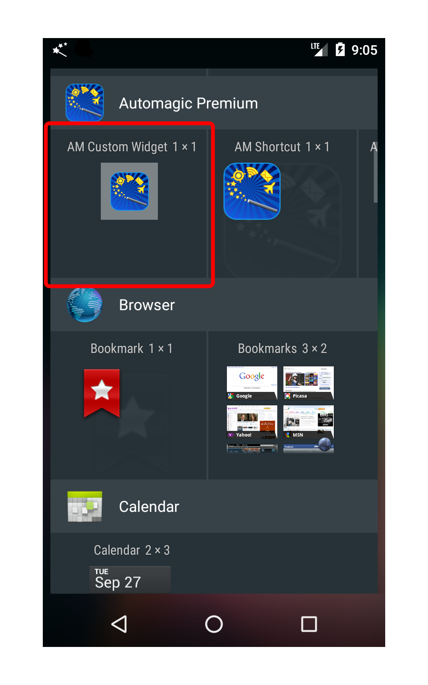

Depending on device, Android version and manufacturer, you can add a widget by long-pressing a free area on the home screen and by selecting **Widgets**.

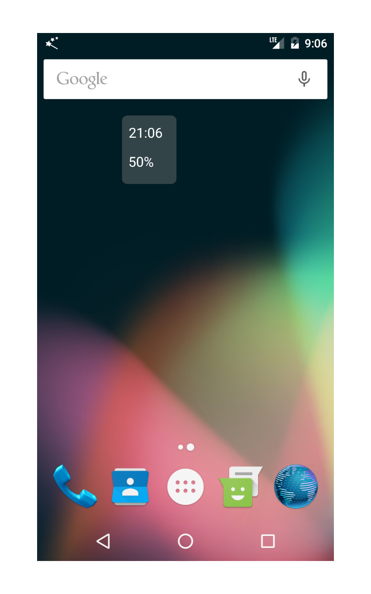

The widget should look approximately as shown in the screenshot. The widget will be updated every minute and every time the battery level changes.

## Step 4 - Adding actions to the widget

In this step we are going to add clickable actions to the widget.
The widget will open the device clock app when the upper half of the widget is pressed and will open the battery usage summary when the lower half of the widget is pressed.

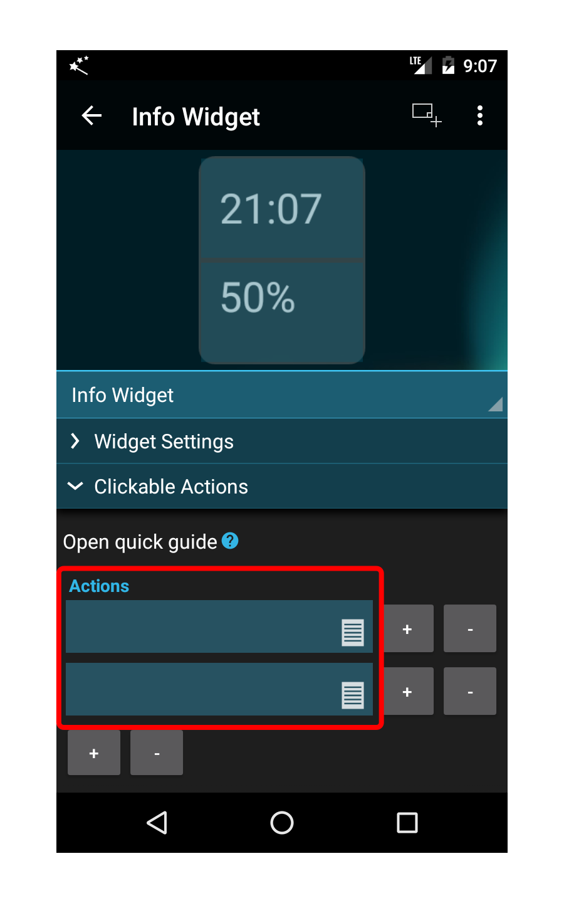

Open the widget (Menu->Custom Widgets then select your Info Widget).
Expand the property group called **Clickable Actions** and add two rows by pressing the [+]-button two times.

The layout of the two clickable actions is also faintly painted in blue in the design area to illustrate where the active regions will be in the widget. Please also read the quick guide available on this screen to get more information about resizing behavior.

You can press one of the two added blue fields to open the action selection dialog. You can either use an existing action or create a new action.

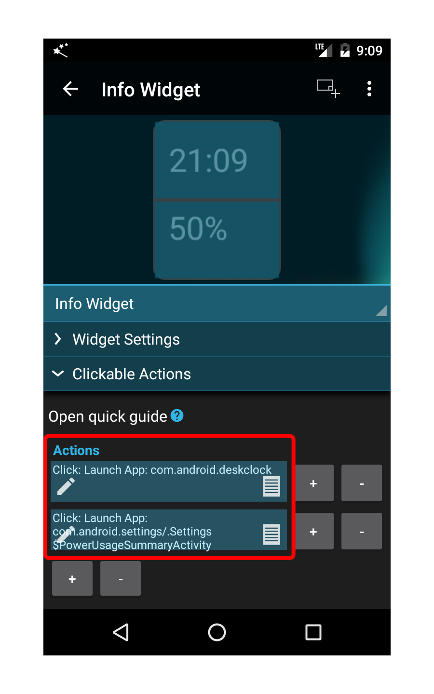

Add an action **Launch App: com.google.android.deskclock** to the first field to start the device clock app when the upper half of the widget is pressed. The package of the clock app can be different on different versions of Android.

Add an action **Launch App: com.android.settings/fuelgauge.PowerUsageSummary** to the second field to open the power usage screen when the lower half of the widget is pressed.

You can use every action available in Automagic on a widget. It's also possible to use an action **Execute Flows** to execute a complete flow consisting of multiple actions and conditions.

Go back to the home screen containing your widget and touch the widget to execute the actions.

## Tips

Automagic allows to modify almost every aspect of a widget element with scripts. You can also use this method to update the widget with the current battery level instead of using a global variable.

To do this, open the action **Script** previously created in this tutorial and press the button **Function** to list all available functions in Automagic. Scroll down and select the function **setWidgetElementProperty**.
Automagic shows a dialog **Widget Property** that allows to select the widget, element and property to modify.

Select the **Info Widget** and the element containing the battery level.
The element could be called **Text\_2** if you did not give a custom name to the element. Select the property **text** and change the value from **{global\_battery\_level}** to **{battery\_level}%** and confirm with OK.
The script should approximately look like this: **setWidgetElementProperty("Info Widget", "Text\_2", "text", "{battery\_level}%");**

Since the widget and the elements are referenced by name, it is a good idea to properly name the widget and the widget elements you want to modify in a script before you start to write complex scripts.

This method is extremely flexible and can be used to achieve almost everything. For example:

- change the background color of the widget to red, when the battery level falls below 30%
- change the image in an image element from a sun to a moon at night
- gradually change the width of a rectangle element to show the battery level using a bar
- use an ellipse/arc to show the battery level in a pie chart style
- create the arms of an analog clock by rotating a thin rectangle element
- switch between two images when toggling a setting
- show the name of the last missed caller in the widget
- change the shadow position of a text element depending on daytime like a sun-dial

Please note that updating a widget is quite a heavyweight process so it is advised to change a widget only when necessary. Battery consumption could be high if you change a widget every 5 seconds.

---

[← Indeks panduan](README.md) · [Peta dokumentasi](../README.md)
