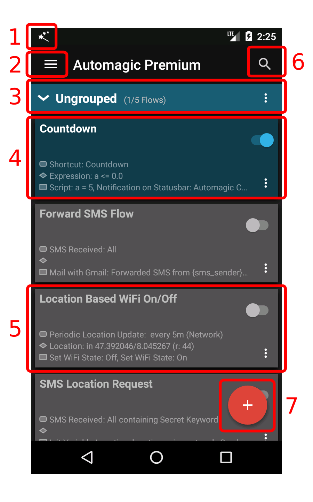
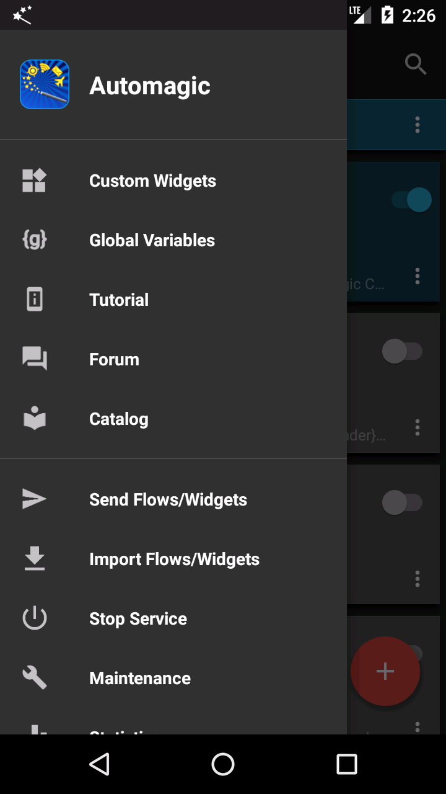
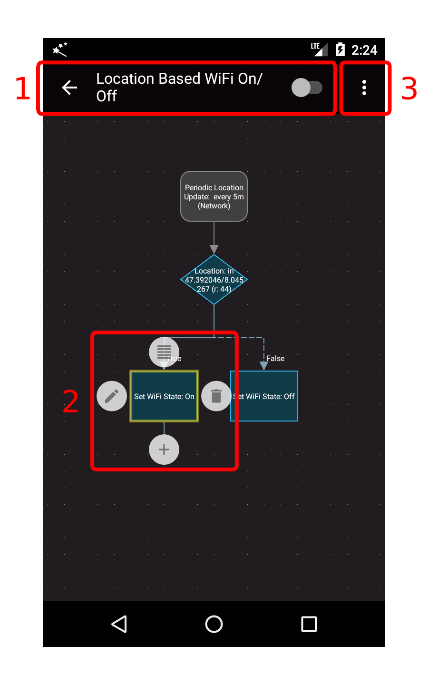
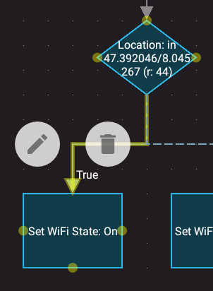
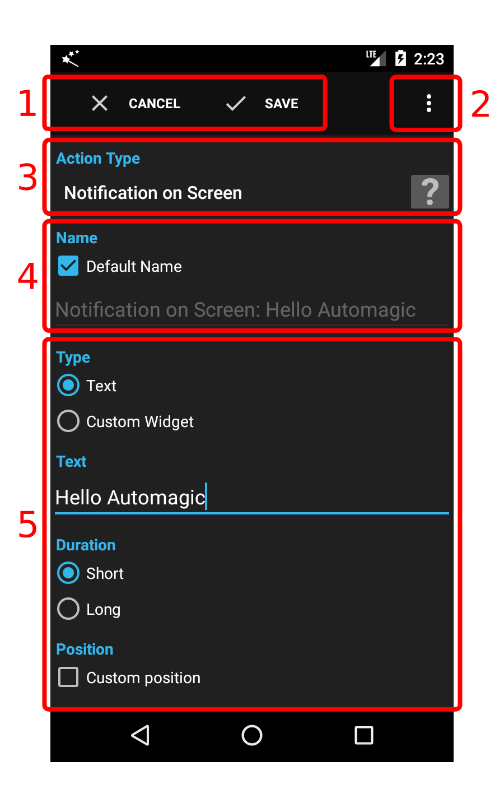
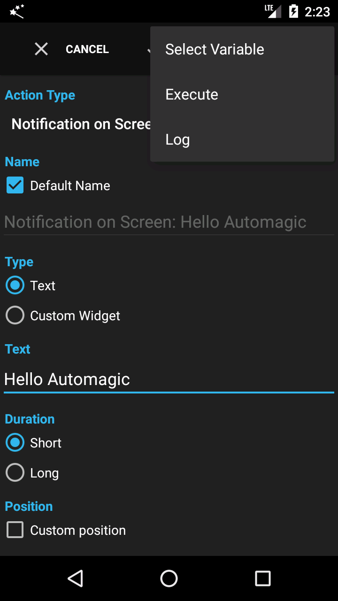

# Main Screens

## Flow List

When you first start Automagic Premium you are presented with the main screen containing a list of predefined flows.

1. Automagic icon indicating that the Automagic service is running
2. Navigation drawer with actions to edit custom widgets, modify settings, to open the catalog and much more
3. A group of flows that can be expanded and collapsed. Select the dropdown icon on the right side to create a new flow and to rename the group.
4. An **enabled** flow is displayed using a blue background color and the switch set to ON. Use the dropdown icon on the right side to execute common actions on the flow.
5. A **disabled** flow is displayed using a grey background color and the switch set to OFF.
6. Search to show flows that contains a certain text.
7. Action to create a new flow. The menu of a group can also be used to create a flow directly in the selected group.

Only the flow "Countdown" is enabled by default when Automagic is started for the first time. All other flows are disabled and therefore rendered in grey. A disabled flow is inactive, not registered with the operating system and hence does not automatically execute anything until the flow is enabled.
You can open and change a flow by selecting the flow in the list.

## Flow List - Menu

1. **Custom Widgets**: Allows to design your own widgets
2. **Global Variables**: Allows to define and edit global variables
3. **Tutorial**: Explains the basic concepts like flows and triggers used in Automagic
4. **Forum**: Opens the forum where you can ask questions and share flows with other users of Automagic
5. **Catalog**: Contains many predefined flows that you can import into Automagic
6. **Send Flows/Widgets**: Allows to select and share flows and widgets
7. **Import Flows/Widgets**: Allows to select and import flows and widgets
8. **Maintenance**: Allows to delete unused triggers, conditions and actions
9. **Statistics**: Shows how many times each flow is executed
10. **Log**: Opens the log of Automagic
11. **Settings**: Item to open the settings of Automagic
12. **About Automagic**: Show version information and release notes
13. **Recommend Automagic**: Tell your friends about Automagic

## Flow

The flow screen can be used to view a flow, watch a flow while the flow is executing and to modify the flow.

A rectangular container with rounded corners contains one or multiple triggers. A flow is executed whenever **one** of the triggers detects an event like an incoming SMS or the WiFi adapter is turned on.
A container with a diamond shape contains a condition that tests if a condition holds true. The flow continues to execute the condition or action in the subsequent container attached at the **true** or **false** output of the condition.
A rectangular container contains an action.
Also see the [Base Concepts](base-concepts.md) for a description.

1. The name of the flow. The switch shows whether the flow is currently enabled (ON) or disabled (OFF).
2. A selected trigger/condition/action with the four main edit commands:
    Selection: Opens the list to reuse an action in this place of the flow.
    Edit: Opens the screen to edit the action.
    Delete: Removes the selected action from this flow. This command does not delete the action definition since the same action might still be used in another flow.
    Add: Drag this icon to a free area on the screen to add a new action or condition.
3. Menu button with actions to enable/disable the flow, manually execute the flow, reset the zoom level, send the flow and to open the log filtered for this flow only

The area containing the flow can be moved around by dragging with the finger in a free area. Pinch zooming is also supported. The menu contains an item to reset the zoom/offset of the flow area in case you can not find your flow anymore.

Touch on a container with triggers, a condition or an action to select the container. You can move a container to another place by dragging the container. The flow is structurally not modified when you rearrange the containers, this means that the flow executes the same actions and stays logically the same.

A connection between two containers can be selected by clicking on the connection.

A connection can be deleted using the trash can. You can modify the visual routing of the connection by selecting the connection and then clicking on one of the four small yellow dots on the source and target container. Note that this does only change the appearance of the connection and does not structurally change the flow.

## Edit Action

1. Buttons to save or cancel the changes you have made to the action. The default behavior when the back button is pressed can be configured in the preferences of Automagic.
   - **Cancel**: Closes the screen and discards the changes made to this action.
   - **Save**: Closes the screen and stores the properties of the action.
2. Menu button to select variables, test execute the action or to open the log.
3. Spinner to change the type.
4. Whether a name should be generated based on the properties of action or a custom name for the action should be used. The name of an action is also the identifier and thus has to be unique.
5. Properties of the action. This area contains the action specific settings and is different for every action type.

## Edit Action - Menu

1. **Select Variable**: Opens a list of variables that are *probably* available for this action when the flow executes. The list contains the variables set by the predecessor actions, conditions and the trigger. Not all variables are guaranteed to be available since some variables are only set conditionally.
2. **Execute**: Executes the action with the currently set properties. Variables are not available when an action is executed using this menu since the action is executed in isolation and the predecessor actions are not executed.
3. **Log**: Opens the log file.

---

[← Indeks panduan](README.md) · [Peta dokumentasi](../README.md)
